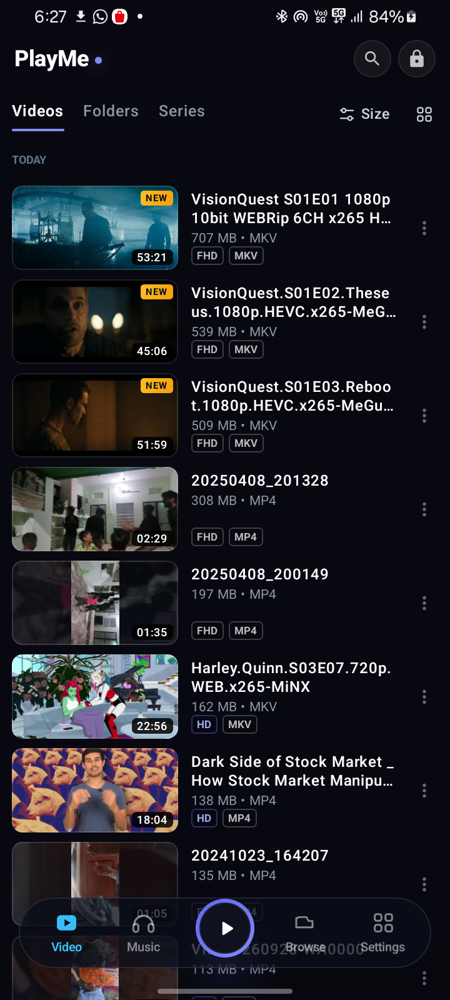
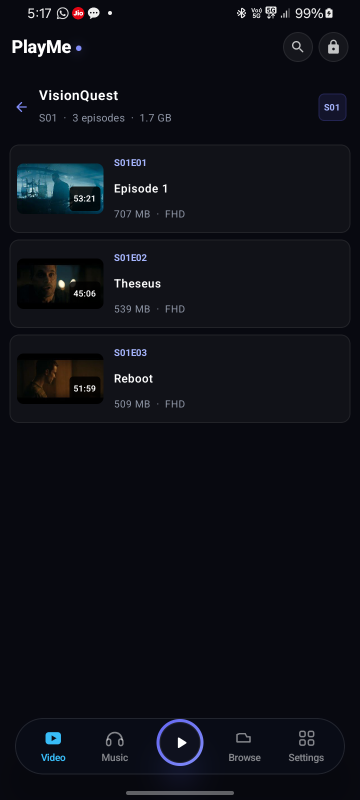
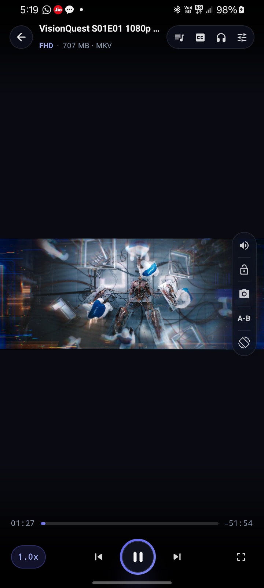
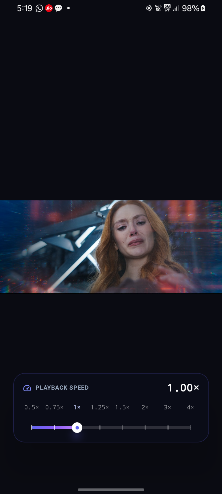

<h1 align="center">PlayMe</h1>

<p align="center">
  <b>A free, beautiful video player for Android.</b><br>
  Finds the videos already on your phone and plays almost any format.
</p>

<p align="center">
  <a href="https://github.com/Mohammad-Shahid-07/playme/releases/download/v0.01/PlayMe-v0.01-arm64-v8a.apk">
    
  </a>
</p>

<p align="center">
  Android 8.0 and newer &nbsp;·&nbsp; 34 MB &nbsp;·&nbsp; Free &nbsp;·&nbsp; No account &nbsp;·&nbsp; No ads
</p>

<p align="center">
  <sub>Version 0.01 (early preview) &nbsp;·&nbsp; <a href="https://github.com/Mohammad-Shahid-07/playme/releases/tag/v0.01">All downloads</a> &nbsp;·&nbsp; <a href="https://github.com/Mohammad-Shahid-07/playme">Source code</a></sub>
</p>

---

## Install in 3 steps

1. **Tap the download button above.**
2. **Open the downloaded file** (it is named `PlayMe-v0.01-arm64-v8a.apk`). If your phone asks, allow your browser to install apps.
3. **Tap Install, then Open.** When PlayMe asks for access to your files, tap **Allow**.

That's it. PlayMe scans your phone and shows your videos in one place.

> **Why does it need file access?** Only to find and play videos stored on your device. PlayMe has no internet permission, so your videos never leave your phone.

### Which download is right for me?

**The big button above is right for almost everyone.** It is for modern 64-bit phones, which covers most phones made in the last 8 years.

Using an older or budget 32-bit phone? [Download the 32-bit version](https://github.com/Mohammad-Shahid-07/playme/releases/download/v0.01/PlayMe-v0.01-armeabi-v7a.apk) instead.

If the main download will not install, the 32-bit version usually fixes "App not installed."

---

## Take a look

| Your video library | Shows, grouped automatically | Episodes in order |
| :---: | :---: | :---: |
|  |  |  |

| Player controls | Playback speed | Settings | Up next |
| :---: | :---: | :---: | :---: |
|  |  |  |  |

---

## What PlayMe can do

- **Play almost any video.** MP4, MKV, AVI, MOV, TS, and more. If your phone struggles with a file, PlayMe switches to a software player automatically.
- **Find all your videos.** Including videos tucked away in folders such as Telegram, WhatsApp, and other apps.
- **Keep shows in order.** Episodes are grouped into series automatically, whether the names use `S01E02`, `1x02`, `Episode 5`, or plain numbers.
- **Pick up where you left off.** A Continue Watching row remembers your place in every video.
- **Control it with simple gestures.** Swipe up or down for brightness and volume, swipe across to seek, double-tap to skip 10 seconds, or hold to speed up.
- **Make it yours.** Change playback speed from 0.5x to 4x, choose audio tracks and subtitles, adjust subtitle timing, set a sleep timer, and change the aspect ratio.

## Your privacy

PlayMe is completely offline. There is no account, no advertising, no tracking, and no internet permission. Your videos stay on your phone.

## Early preview: what is not ready yet

This is the first public release (`v0.01`), so some parts are still placeholders:

- The **Music**, **Browse**, and **Settings** tabs at the bottom are not finished. The **Videos** tab is the main working screen.
- **Picture-in-Picture**, **floating window**, and **background playback** are planned but not available yet.
- The **Private Vault** and video overflow menus are not wired up yet.
- **Save frame as image** currently shows a message but does not save the image.
- Opening a video from another app (for example, a file manager) is not supported yet.

The important parts are ready: finding videos, grouping series, and playback.

## Troubleshooting

**"App not installed"**  
Try the [32-bit download](https://github.com/Mohammad-Shahid-07/playme/releases/download/v0.01/PlayMe-v0.01-armeabi-v7a.apk). Also check that your browser or file manager is allowed to install apps.

**"No videos found"**  
Open **Settings → Apps → PlayMe → Permissions** and allow access to videos and files, then reopen PlayMe.

**A video will not play or has no sound**  
Open the player settings (gear icon) and switch the engine from **HW** to **SW**. SW uses the built-in VLC engine, which handles more formats.

**Subtitles are not showing**  
Open the player settings and choose a subtitle track under **Subtitles**. Use the same panel to change the subtitle size or timing.

---

<details>
<summary><b>For developers: technical details, checksums, and build instructions</b></summary>

### Overview

PlayMe pairs a dark-glass Jetpack Compose UI (**Obsidian Violet Liquid Glass**, defined in [`DESIGN.md`](DESIGN.md) and [`ui_prototype/`](ui_prototype/)) with a dual-engine native playback stack. It scans device storage progressively, groups multi-episode shows deterministically into series, extracts thumbnails even for streams skipped by platform decoders (such as 10-bit HEVC), and keeps playback responsive across Android 8.0 through Android 15 (including Android 9 / API 28 and display-cutout devices).

**Status:** `v0.01 (Pre-release)` (`versionCode = 1`, `minSdk = 26` / Android 8.0+, `targetSdk = 35`)  
**Repository:** [`Mohammad-Shahid-07/playme`](https://github.com/Mohammad-Shahid-07/playme)

### Verified capabilities (`v0.01`)

#### Dual-engine playback (`UniversalPlayerEngine`)
* **Primary hardware engine ([`PlayMePlayerEngine`](app/src/main/java/com/playme/player/core/player/PlayMePlayerEngine.kt)):** AndroidX Media3 ExoPlayer (`1.5.1`) configured with `DefaultRenderersFactory` (`EXTENSION_RENDERER_MODE_ON` and decoder fallback enabled).
* **Universal fallback and software engine ([`VlcPlayerEngine`](app/src/main/java/com/playme/player/core/player/VlcPlayerEngine.kt)):** LibVLC (`3.6.5`) powers `SW` decoder mode, automatic fallback if ExoPlayer encounters a playback error, and upfront routing for `.ts` and `.m2ts` transport streams.
* **MPEG-TS PTS normalization:** [`UniversalPlayerEngine`](app/src/main/java/com/playme/player/core/player/UniversalPlayerEngine.kt) detects large non-zero initial PTS offsets (`> 5,000 ms`) on `.ts`/`.m2ts` captures and normalizes timeline position and duration back to `00:00`.
* **Audio focus and headset disconnect protection ([`PlayerAudioFocusEffect`](app/src/main/java/com/playme/player/feature/player/ui/PlayerAudioFocusEffect.kt)):** Acts as the single audio-focus owner (`AudioFocusRequest` on API 26+ with main-thread `Handler`) across both engines, pausing on focus loss/transient loss (resuming on `AUDIOFOCUS_GAIN` when paused by focus) and pausing on `ACTION_AUDIO_BECOMING_NOISY`.

#### FFmpegKit thumbnails and seek-bar frame previews
* **Four-tier cover pipeline ([`ThumbnailDecoder`](app/src/main/java/com/playme/player/core/scanner/ThumbnailDecoder.kt), [`ThumbnailManager`](app/src/main/java/com/playme/player/core/scanner/ThumbnailManager.kt)):**
  1. App disk cache (`cacheDir`) + in-memory `LruCache` + Coil 3 (`coil-video`).
  2. System thumbnails (`ContentResolver.loadThumbnail` on API 29+, `MediaStore.Video.Thumbnails.getThumbnail` on API 26–28).
  3. `MediaMetadataRetriever` at 10% duration (with dark-frame detection and `.nomedia` path fallback).
  4. Software frame extraction via [`FfmpegFrameExtractor`](app/src/main/java/com/playme/player/core/scanner/FfmpegFrameExtractor.kt) (`ffmpeg-kit-lts-min-16kb` `6.1.4`) for streams platform decoders reject, such as 10-bit HEVC.
* **On-demand seek previews ([`SeekPreviewFrames`](app/src/main/java/com/playme/player/core/scanner/SeekPreviewFrames.kt), [`SeekPreviewBubble`](app/src/main/java/com/playme/player/feature/player/ui/SeekPreviewBubble.kt)):** Splits the timeline into `24` buckets and decodes `160×90` letterboxed preview frames on demand using per-bucket locking and atomic temp-file writes.

#### Progressive two-stage library and deterministic series grouping
* **Two-stage discovery ([`VideoRepository`](app/src/main/java/com/playme/player/core/repository/VideoRepository.kt), [`MediaStoreScanner`](app/src/main/java/com/playme/player/core/scanner/MediaStoreScanner.kt), [`DeepStorageScanner`](app/src/main/java/com/playme/player/core/scanner/DeepStorageScanner.kt)):**
  * Emits cached snapshots immediately (`LibrarySnapshotStore`) while stripping deleted files.
  * Queries `MediaStore.Video.Media` (with `RESOLUTION` fallback on API 28 rows missing `WIDTH`/`HEIGHT`) and watches for media changes via a debounced `ContentObserver`.
  * Recursively walks storage (up to depth `7`, files `>= 500 KB` across `mp4`, `mkv`, `webm`, `avi`, `mov`, `flv`, `3gp`, `m4v`, `ts`, `wmv`, `mpg`, `mpeg`) to index videos inside `.nomedia` folders such as Telegram and WhatsApp, memoizing metadata in `MediaMetadataStore`.
* **Cross-version storage access ([`StorageAccess`](app/src/main/java/com/playme/player/core/permissions/StorageAccess.kt), [`MainActivity`](app/src/main/java/com/playme/player/MainActivity.kt)):** Uses `MANAGE_EXTERNAL_STORAGE` on Android 11+ (API 30+) and runtime `READ_EXTERNAL_STORAGE` (with rationale/App Info fallback and `requestLegacyExternalStorage="true"` on API 29) on Android 8.0–10 (API 26–29).
* **Deterministic series grouping ([`TitleNormalizer`](app/src/main/java/com/playme/player/core/grouping/TitleNormalizer.kt), [`EpisodeParser`](app/src/main/java/com/playme/player/core/grouping/EpisodeParser.kt), [`SeriesGrouper`](app/src/main/java/com/playme/player/core/grouping/SeriesGrouper.kt)):** Recognizes `S01E02`, `S01EP02`, `1x02`, `Season X Episode Y`, `[01-13]`, `EP02`, `Episode 2`, `Part 1`, `CD1`, `Lecture 05`, and bare trailing numbers (excluding camera prefixes like `VID 001` and grade labels like `Class 10`). Groups by normalized title stem *after* stripping markers and release tags, requires at least 2 episodes per series, isolates remakes by year, and prevents shared-prefix false merges (`S01_ShowA_E01` vs `S01_ShowB_E01`).
* **Library views and history:** `Videos`, `Folders`, and `Series` tabs in a `HorizontalPager`, List/2-column Grid toggle, sorting (`Newest`, `Name`, `Size`, `Duration`), real-time search by title or folder, and a `Continue Watching` carousel persisted asynchronously in [`WatchProgressStore`](app/src/main/java/com/playme/player/core/history/WatchProgressStore.kt).

#### Player HUD, gestures, and controls
* **Gesture layer ([`PlayerGestureDetector`](app/src/main/java/com/playme/player/feature/player/ui/PlayerGestureDetector.kt), [`PlayerGestureHandlers`](app/src/main/java/com/playme/player/feature/player/ui/PlayerGestureHandlers.kt), [`GestureOverlayHUD`](app/src/main/java/com/playme/player/feature/player/ui/GestureOverlayHUD.kt)):**
  * Single tap toggles HUD (auto-hides after `3.5s` during playback); double-tap outer thirds (`30%`) seeks `-10s` / `+10s`, center toggles play/pause.
  * Left vertical swipe adjusts screen brightness; right vertical swipe adjusts device `STREAM_MUSIC` volume (bidirectionally synced via `ContentObserver` without double-attenuating engine output); horizontal swipe scrubs the timeline. Includes diagonal slope guards and system-edge deadzones.
  * Long-press (`280 ms` hold) activates hold-to-boost playback (`2.0x` default), and dragging horizontally selects across `0.25x`, `0.5x`, `0.75x`, `1.5x`, `2.0x`, `3.0x`, and `4.0x` ([`QuickSpeedBoostHUD`](app/src/main/java/com/playme/player/feature/player/ui/QuickSpeedBoostHUD.kt)).
* **Speed Studio dock ([`PlaybackSpeedStudioDock`](app/src/main/java/com/playme/player/feature/player/ui/PlaybackSpeedStudioDock.kt), [`PlaybackSpeedSlider`](app/src/main/java/com/playme/player/feature/player/ui/PlaybackSpeedSlider.kt)):** Tactile speed ruler and precision slider from `0.5x` to `4.0x` (plus `0.25x–4.0x` hold-boost presets) with a `1.0x` reset pill.
* **Settings sidebar ([`PlayerSettingsSidebar`](app/src/main/java/com/playme/player/feature/player/ui/PlayerSettingsSidebar.kt), [`SettingsRootView`](app/src/main/java/com/playme/player/feature/player/ui/SettingsRootView.kt), [`PlayerSettingsSubViews`](app/src/main/java/com/playme/player/feature/player/ui/PlayerSettingsSubViews.kt)):**
  * **Audio:** Track switching, Audio Sync delay (`±5000ms` range in `±0.1s` / `±0.5s` steps with independent Reset), and Volume Boost (`100%–200%`, up to `8,000 mB` / `+80 dB` target gain via `LoudnessEnhancer` on ExoPlayer or `0–200` software volume on LibVLC).
  * **Subtitles:** Track switching, Font Size (`Normal`, `Large`, `Extra Large`), Subtitle Sync delay (`±0.2s` steps with independent Reset), and on-screen subtitle pill.
  * **Playback and display:** `HW` (Media3) / `SW` (LibVLC) engine switch, Sleep Timer (`Off`, `15m`, `30m`, `45m`, `60m`), Aspect Ratio (`Best Fit`, `Fit Screen`, `Fill`, `16:9`, `4:3`, `Original`), Ambient Edge Glow (API 31+ `Modifier.blur` with API 26–30 `Canvas` radial fallback), and Screen Brightness (`10%–100%` / `Auto`).
* **Queue, side dock, and fullscreen ([`QueueBottomSheet`](app/src/main/java/com/playme/player/feature/player/ui/QueueBottomSheet.kt), [`PlayerSideDock`](app/src/main/java/com/playme/player/feature/player/ui/PlayerSideDock.kt), [`PlayerScreen`](app/src/main/java/com/playme/player/feature/player/ui/PlayerScreen.kt)):**
  * Queue drawer with Now Playing, Up Next list, remove / Clear All, Shuffle (preserving/restoring pre-shuffle order), Repeat (`off`, `all`, `one`), and Autoplay.
  * Side dock with Mute, Controls Lock, A-B Loop (`+5s` segment loop from marked start), and Rotate / Fullscreen toggle (`WindowInsetsControllerCompat` + `values-v28` `shortEdges` cutout support).

#### Architecture
* **Modular MVI:** Immutable `StateFlow` UI states (`LibraryState`, `PlayerState`) and typed `LibraryAction` / `PlayerAction` intents routed through `LibraryViewModel` and `PlayerViewModel` to focused delegates (`PlayerTransportController`, `PlayerQueueController`, `PlayerSessionEffects`, `PlayerSettingsDelegate`).
* **File-size discipline:** Every Kotlin file under `app/src/main/java` stays within [`AGENTS.md`](AGENTS.md)'s 300-line ceiling (`<= 296` lines).

### Pre-release scope and known limitations

PlayMe `v0.01` is an early pre-release focused on local video discovery and playback. The following areas are **not yet implemented** or are UI placeholders:

* **Navigation tabs and center play button:** Only the **Video** tab (`LibraryScreen`) is active; **Music**, **Browse**, and **Settings** render placeholder cards ([`MainTabPlaceholderView`](app/src/main/java/com/playme/player/feature/navigation/MainTabPlaceholderView.kt)), and the center dock Play button in [`BottomNavBar`](app/src/main/java/com/playme/player/feature/navigation/BottomNavBar.kt) is currently unwired.
* **Vault, overflow menu, and frame snapshot:** The Private Vault lock button in [`LibraryTopBar`](app/src/main/java/com/playme/player/feature/library/ui/LibraryTopBar.kt) and item overflow menus are not yet wired, and the Frame Snapshot button in [`PlayerSideDock`](app/src/main/java/com/playme/player/feature/player/ui/PlayerSideDock.kt) currently displays a toast without saving an image.
* **Background playback, PiP, and floating window:** While permissions and `supportsPictureInPicture="true"` are declared in [`AndroidManifest.xml`](app/src/main/AndroidManifest.xml), `PlaybackService`, `MediaSession` media notifications, Picture-in-Picture lifecycle handling, and floating pop-up windows are planned for future milestones (the `Background Audio` and `Dialogue Clarity` toggles in Player Settings currently update UI state/toasts only).
* **External file intents:** Launching PlayMe from external file managers via `ACTION_VIEW` intents is planned for a future milestone.
* **Signing:** Pre-release `assembleRelease` APKs are signed with the `localRelease` debug-keystore configuration in [`app/build.gradle.kts`](app/build.gradle.kts) (`~/.android/debug.keystore`) rather than a production release key.

### Downloads and checksums

PlayMe splits APKs by ABI because LibVLC and FFmpegKit bundle native libraries per architecture (avoiding a ~115 MB universal APK; `x86`/`x86_64` emulator ABIs are excluded).

| APK file | ABI | Size (bytes) | SHA-256 checksum | Device compatibility |
| :--- | :--- | ---: | :--- | :--- |
| [`PlayMe-v0.01-arm64-v8a.apk`](https://github.com/Mohammad-Shahid-07/playme/releases/download/v0.01/PlayMe-v0.01-arm64-v8a.apk) | `arm64-v8a` | `33,884,373` | `c5a740ad16c609562a5da633a597df643a21b2b14af5f3bdd7e4eba7558da809` | **Recommended** for most modern 64-bit ARM phones and tablets (Android 8.0+). |
| [`PlayMe-v0.01-armeabi-v7a.apk`](https://github.com/Mohammad-Shahid-07/playme/releases/download/v0.01/PlayMe-v0.01-armeabi-v7a.apk) | `armeabi-v7a` | `30,848,878` | `cea0221a64b75c976438ce8a7b4ff194e9de787fe9bf207f9a525a9741961c5f` | Older 32-bit ARM devices or 32-bit Android OS builds. |

Verify checksums before installing:

On Linux / macOS:
```bash
sha256sum PlayMe-v0.01-*.apk
```

On Windows PowerShell:
```powershell
Get-FileHash .\PlayMe-v0.01-*.apk -Algorithm SHA256
```

### Building from source

#### Android app (`:app`)

**Requirements:**
* Android SDK (`compileSdk = 35`, `minSdk = 26`, `targetSdk = 35`) configured in `local.properties` (or `ANDROID_HOME`)
* JDK 21 (`JavaVersion.VERSION_21` in [`app/build.gradle.kts`](app/build.gradle.kts); [`gradle.properties`](gradle.properties) configures `org.gradle.java.home` for Android Studio's JBR on Windows)
* A keystore at `~/.android/debug.keystore` (`storePassword = "android"`, `keyAlias = "androiddebugkey"`, `keyPassword = "android"`) for the `localRelease` signing configuration in [`app/build.gradle.kts`](app/build.gradle.kts)

**Build release APKs (R8 minified + ABI-split):**

* **macOS / Linux:**
  ```bash
  ./gradlew assembleRelease
  ```
* **Windows (PowerShell / CMD):**
  ```powershell
  .\gradlew.bat assembleRelease
  ```

Split release APKs are written to `app/build/outputs/apk/release/` (`app-arm64-v8a-release.apk` and `app-armeabi-v7a-release.apk`).

**Run Android Lint:**
```powershell
.\gradlew.bat lintRelease
```
*(Use `./gradlew lintRelease` on macOS/Linux.)*

> **Note on release signing:** [`app/build.gradle.kts`](app/build.gradle.kts) currently configures `signingConfigs.create("localRelease")` using `~/.android/debug.keystore` for local release benchmarking. Replace this with your own keystore configuration before distributing production builds.

#### Design prototype (`ui_prototype/`)

The interactive React + TypeScript design prototype in [`ui_prototype/`](ui_prototype/) uses [`bun`](https://bun.sh) (see [`ui_prototype/package.json`](ui_prototype/package.json)):

```bash
cd ui_prototype
bun install
bun run dev      # Start Vite dev server
bun run build    # Type-check (tsc -b) and build production bundle
bun run lint     # Run oxlint
bun run preview  # Preview production build
```

</details>

---

<p align="center">
  <sub>Built with Kotlin, Jetpack Compose, Media3, LibVLC, and FFmpegKit.</sub><br>
  <sub>Found a bug? <a href="https://github.com/Mohammad-Shahid-07/playme/issues">Open an issue</a> · <a href="https://github.com/Mohammad-Shahid-07/playme">Star the project on GitHub</a></sub>
</p>
